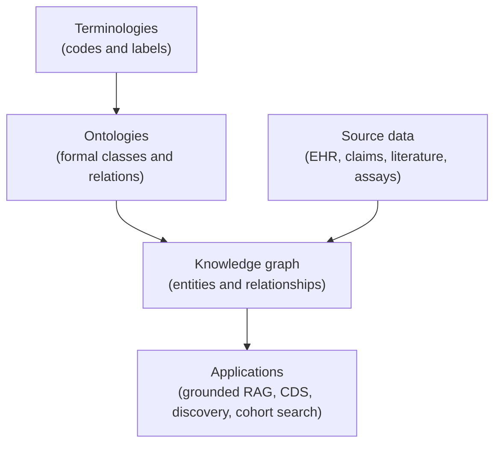
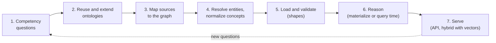

# Building knowledge graphs & ontologies for HLS

> _Last reviewed: 2026-08-05 — see the [freshness policy](../appendix/maintenance.md)._

## Learning objectives

After this chapter you will be able to:

- Distinguish a terminology, an ontology, a knowledge graph, and a data model — and know which one a problem actually needs.
- Choose between an RDF/OWL stack and a property graph for a given HLS workload.
- Follow a build sequence that starts from the questions the graph must answer, not from the technology.

## Four things people conflate

Most failed "knowledge graph" projects start by treating four different artifacts as one. The
book has met each of them already, in separate chapters; this is how they relate.

| Artifact | What it is | HLS example | Where this book covers it |
| --- | --- | --- | --- |
| **Terminology / code system** | Codes with labels and, at most, a simple hierarchy | ICD-10-CM, LOINC, RxNorm | [Clinical terminologies](../02-interoperability/03-terminologies.md) |
| **Ontology** | Formal, machine-interpretable definitions of classes and relations, with logic that supports inference | SNOMED CT, Human Phenotype Ontology, Gene Ontology, DUO | [Genomics data standards](../07-genomics/04-genomics-data-standards.md) (DUO, Phenopackets) |
| **Knowledge graph** | A populated graph of *entities and relationships*, organized by an ontology or schema | Genes, drugs, diseases, pathways and the evidence linking them | This chapter |
| **Data model** | A schema optimized to store or exchange records for one system | OMOP CDM, FHIR resources | [OMOP CDM](../02-interoperability/04-omop-cdm.md), [FHIR](../02-interoperability/01-fhir.md) |

The shortest correct summary: **the ontology is the meaning; the knowledge graph is the data that
uses it.** A data model optimizes storage and exchange; an ontology optimizes *inference*. You can
have an ontology with no graph (a published vocabulary) and a graph with a thin ad hoc schema (a
common and fragile outcome).

## When a graph earns its place — and when it doesn't

**Build one when:**

- Questions are **multi-hop** across heterogeneous sources: *"which approved drugs act on targets in
  pathways implicated in the disease associated with this patient's variant?"* — a query that is a
  five-way join in SQL and a short traversal in a graph.
- You need **inference over a hierarchy** — every descendant of "chronic kidney disease," every
  phenotype subsumed by a parent term — and want the semantics defined once, not re-coded per query.
- You are integrating **external knowledge** (public ontologies, curated databases) with internal
  data, where shared identifiers do the joining.
- You need **explainable provenance** — *why* does the system believe this link — for science or
  audit.

**Don't build one when** the questions are single-source reporting or cohort counts. OMOP already
gives you a closed, relational is-a hierarchy: `concept_ancestor` is a precomputed transitive
closure, and for most observational-research hierarchy queries that is enough. A graph that
re-implements a hierarchy OMOP already serves is cost without capability.

## RDF/OWL versus property graph

Two mature families, solving overlapping problems with different philosophies:

| | RDF / OWL / SPARQL | Property graph |
| --- | --- | --- |
| **Model** | Triples (subject, predicate, object) identified by IRIs; schema in RDFS/OWL | Nodes and edges that carry their own key-value properties |
| **Strength** | Standards-based identifiers, ontology reuse, formal reasoning, linked-data integration | Developer-friendly traversal and graph analytics; intuitive for application models |
| **Query** | SPARQL (W3C) | openCypher, Gremlin, and the ISO standard **GQL** (ISO/IEC 39075:2024) |
| **Validation** | **SHACL** (W3C) shapes; FHIR itself defines its RDF shapes in ShEx | Schema constraints, varying by engine |
| **Best fit in HLS** | Biomedical ontology integration, semantic interoperability, reasoning | Patient-journey analytics, recommendation, network/fraud analysis |

The decision is less ideological than it looks: **if you must reuse and align with public
biomedical ontologies, RDF/OWL gives you the ecosystem; if you are modeling an application's own
domain for traversal and analytics, a property graph is usually faster to build.** They also
coexist — and SQL itself now has a graph-query part (SQL/PGQ, ISO/IEC 9075-16:2023), so graph
queries over relational data are an increasingly standard option rather than a separate database.

**FHIR and RDF.** FHIR defines a Turtle (RDF) serialization (`application/fhir+turtle`), so FHIR
resources can enter an RDF graph without bespoke mapping. FHIR's RDF spec validates with **ShEx**
rather than SHACL — a detail worth knowing before you plan your validation tooling.

## The ontologies you should reuse instead of inventing

The single most valuable rule in ontology work: **reuse before you build.** Biomedicine already has
a large, curated ecosystem, much of it under the **OBO Foundry** — a community that publishes
ontologies to shared principles (open licensing, common formats, stable identifiers):

- **SNOMED CT** — clinical findings and procedures; its concept definitions are expressed in a
  description-logic formalism, which is what makes subsumption queries meaningful.
- **Human Phenotype Ontology (HPO)** — phenotypic abnormalities; the phenotype vocabulary behind
  GA4GH [Phenopackets](../07-genomics/04-genomics-data-standards.md).
- **Gene Ontology (GO)** — gene and gene-product function.
- **MONDO / ChEBI / Uberon** — diseases, chemical entities, and anatomy, respectively.
- **UMLS Metathesaurus** — a crosswalk that maps many vocabularies onto shared concepts, the
  practical glue when your sources use different code systems (see
  [terminologies](../02-interoperability/03-terminologies.md)).

An ontology you invent that overlaps these is an ontology no outside collaborator or tool can
interoperate with. Extend theirs with your local classes; don't fork the whole thing.

## A build sequence

1. **Write the competency questions first.** A dozen concrete questions the graph must answer
   ("which trials enrolled patients with HPO term X and variant Y?"). They define scope, expose
   which ontologies you need, and become your acceptance tests. A graph built without them tends to
   model everything and answer nothing.
2. **Reuse and extend ontologies.** Pick existing ones per the list above; add only the local
   classes that are genuinely yours, under stable, owned IRIs.
3. **Map sources to the graph.** For relational sources, declarative mapping (R2RML/RML) beats
   hand-written ETL because the mapping itself is reviewable. For FHIR, use the RDF serialization
   or flatten via [SQL-on-FHIR](../02-interoperability/07-sql-on-fhir.md) first. Land raw sources
   in the [lakehouse bronze layer](./08-building-health-lakehouse.md) and build the graph from
   silver, so the graph stays reproducible.
4. **Resolve entities and normalize concepts.** The same drug arrives as an RxNorm code, a brand
   name, and a free-text mention; the same patient as three MRNs. Concept normalization goes
   through a terminology service; person matching reuses the
   [identity-matching](../02-interoperability/13-patient-provider-identity.md) discipline.
   Unresolved identity is the main reason graphs turn into disconnected hairballs.
5. **Load and validate against shapes.** SHACL (or ShEx, for FHIR-shaped data) states what a valid
   node looks like and rejects violations at load time — the graph equivalent of a
   [data contract](./03-governance-contracts.md).
6. **Decide where reasoning happens.** *Materialize* inferred triples at load time (fast queries,
   storage cost, re-run on ontology change) or reason at *query time* (always current, slower).
   Reasoning over a large clinical ontology is expensive; budget for it explicitly.
7. **Serve it.** A query endpoint (SPARQL or a graph API), commonly combined with vector search so
   a question can match fuzzy text *and* traverse structure.

## Where to run it

| Option | Model | Notes |
| --- | --- | --- |
| **Amazon Neptune** | RDF (SPARQL) and property graph (Gremlin, openCypher) | One managed service covering both families |
| **Neo4j** | Property graph (Cypher) | Widely used; managed offerings on the major clouds |
| **Google Cloud Spanner Graph** | Property graph via ISO GQL and SQL/PGQ | Graph queries over a relational, globally distributed store |
| **Azure Cosmos DB for Apache Gremlin** | Property graph (Gremlin) | Azure-native option |
| **Triple stores** (GraphDB, Stardog, Virtuoso, Apache Jena) | RDF / OWL / SPARQL, reasoning | Choose when OWL reasoning and ontology tooling are central |

Vendor capabilities move quickly — confirm current feature support before committing. The
portability guidance from [cloud portability](../04-cloud-platforms/08-portability-lock-in.md)
applies: **keep your ontology and mappings in open standards (OWL, RDF, SHACL, R2RML) even if the
store is proprietary**, because the store is replaceable and the semantics are the asset.

## Patient data and the knowledge graph: separate them

A *reference* knowledge graph (genes, drugs, diseases, public evidence) holds no PHI and can be
shared widely. A *patient* graph (individuals and their facts) is PHI and inherits everything from
[HIPAA](../03-compliance/00-hipaa.md) and [consent](../03-compliance/09-consent-management-architecture.md).
**Keep them as separate graphs and join at query time.** Mixing patient facts into a shared
reference graph makes the whole thing PHI, makes fine-grained access control hard (per-triple
authorization is notoriously difficult), and makes the reference knowledge impossible to share.
Capture provenance (which source, version, and curator asserted each fact) using named graphs or
edge properties — the same discipline as [data lineage & provenance](./07-data-lineage-provenance.md).

## Knowledge graphs and LLMs

The two are complementary, which is the main reason interest in graphs resurged:

- **Graph-grounded retrieval (GraphRAG-style).** Instead of retrieving only by text similarity,
  retrieve from the graph — a multi-hop traversal returns structured, attributable facts. This
  helps with questions plain [RAG](../06-ai-ml/02-rag-clinical.md) handles poorly (*relationships*
  across documents) and makes answers traceable to edges and sources. It improves grounding; it
  does not eliminate confabulation, so the
  [GenAI application stack](../06-ai-ml/10-genai-app-stack.md) controls still apply.
- **LLM-assisted construction.** Models can propose entities and relations from clinical text or
  literature, but extraction errors become false *facts* in a graph that later reasoning treats as
  true. Keep a human curation step and record extraction confidence and provenance.
- **Ontologies as guardrails.** A formal ontology constrains what an agent may assert or call,
  which is useful input to the tool-scoping discussed in [agentic AI](../06-ai-ml/03-agentic-ai.md).

## Common failure modes

- **No competency questions** — an unbounded modeling exercise with no definition of done.
- **Reinventing ontologies** that already exist, then being unable to interoperate.
- **Unstable identifiers** — IRIs that change between loads break every downstream link.
- **The hairball** — no entity resolution, so the same real-world thing is many disconnected nodes.
- **Unowned curation** — a graph is a living asset; without a named owner it decays faster than a
  table does, because errors propagate along edges.
- **Using a graph where a join would do** — reasoning machinery adopted for a problem
  `concept_ancestor` already solves.

## Design guidance

1. **Start from competency questions**, and keep them as the regression suite.
2. **Reuse OBO Foundry and SNOMED/UMLS-aligned ontologies**; extend, don't fork.
3. **Separate the reference graph from the patient graph** and join at query time.
4. **Validate with shapes at load time** — the graph's data contract.
5. **Store semantics in open standards**, so the graph engine remains replaceable.
6. **Treat LLM-extracted triples as untrusted** until curated, with provenance recorded.

## Check yourself

1. A colleague says "we need an ontology" and means a list of ICD-10 codes with labels. Which of the
   four artifacts is that, and what would make it an ontology?
2. A cohort question needs "all patients with any descendant of diabetes mellitus." Does that
   justify a knowledge graph in an OMOP environment? What already answers it?
3. Why keep a reference knowledge graph and a patient graph separate rather than loading patient
   facts into one shared graph?

## Further reading

- [OBO Foundry](https://obofoundry.org/) · [Human Phenotype Ontology](https://hpo.jax.org/) · [Gene Ontology](https://geneontology.org/)
- [UMLS](https://www.nlm.nih.gov/research/umls/index.html) · [SNOMED International](https://www.snomed.org/)
- [W3C SPARQL 1.1](https://www.w3.org/TR/sparql11-overview/) · [W3C SHACL](https://www.w3.org/TR/shacl/) · [W3C OWL 2](https://www.w3.org/TR/owl2-overview/)
- [FHIR RDF (Turtle) and ShEx](https://hl7.org/fhir/rdf.html) · [ISO/IEC 39075 GQL (JTC 1 overview)](https://www.jtc1info.org/wp-content/uploads/2024/04/2024-Article-39075-Database-Language-GQL.docx.pdf)
- [Clinical terminologies](../02-interoperability/03-terminologies.md) · [OMOP CDM](../02-interoperability/04-omop-cdm.md) · [RAG over clinical corpora](../06-ai-ml/02-rag-clinical.md)
